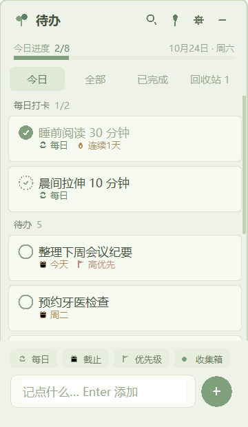

# 待办

一个**悬浮窗待办记事本**:无边框小窗悬浮在桌面上,不在任务栏显示图标,
静默常驻后台,支持每日打卡任务、清单、回收站、主题插件等。

纯 Python 标准库(tkinter + ctypes)实现,**零第三方依赖**,仅适配 Windows 10/11。



## 快速开始

| 操作 | 方式 |
| --- | --- |
| 启动(显示悬浮窗) | 双击 **启动待办.bat** |
| 静默启动(仅后台待命) | 双击 **启动待办(静默后台).bat** |
| 显示 / 隐藏窗口 | 全局热键(默认 **Ctrl+Alt+Space**;被占用时自动换可用键)+ **托盘图标左键单击** |
| 退出应用 | 设置 → 退出应用 |

> 没有命令行窗口、没有任务栏图标、不在 Alt-Tab 里出现——真正的"隐身"悬浮。
> 窗口被收起后,用热键呼出,或再次双击 `启动待办.bat`(已有实例在跑时会直接把窗口唤出来)。

## 功能清单

- **托盘图标**:常驻在任务栏右下角(箭头展开的溢出区),**左键单击**即弹出/隐藏悬浮窗,右键可显示/隐藏或退出;可把它拖到箭头外常驻显示

- **待办管理**:添加 / 编辑 / 删除 / 恢复,标题、备注、优先级、所属清单
- **截止日历**:点"截止"芯片弹出月历,自选任意日期+几点几分(‹›翻月,今天有描边);也支持快捷今天/明天/下周一/清除
- **打勾**:圆圈打勾,今日完成项归入"今日已完成"分组(可折叠)
- **每日任务**:按自然日打卡,自动重置,记录**连续天数**与最佳纪录
- **四个视图**:今日(每日打卡 + 待办 + 今日已完成)/ 全部(按清单分组)/ 已完成 / 回收站(可恢复或彻底删除)
- **清单**:自定义清单,删除清单时任务自动移回收集箱
- **搜索**:标题 + 备注全文过滤
- **排序**:按住卡片拖动排序(取插入点前后邻居的中间值,不打乱其他顺序)
- **今日进度条**:完成数 / 总数,逾期计数提醒
- **窗口体验**:
  - 标题栏拖动移动;**八条边都可拖拽缩放**(300×460 ~ 1000×1500)
  - 悬浮置顶开关(标题栏📌或设置里)
  - 不透明度 40%~100% 无级调节
  - 大小位置自动记忆,下次启动原样恢复
  - 打开时提醒"今天有 N 项待完成(其中 M 项已逾期)"
- **数据**:自动保存到 `data/todo.json`,支持导出/导入 JSON 备份
- **开机自启**:设置里一键开关(写入注册表 HKCU Run,静默启动不弹窗)

## 主题与皮肤插件

内置 **青苔**(低饱和灰绿)主题;`themes/` 目录下的插件**放进去即可用**:

- **配色插件**(`.json`):全量换色 + 圆角 + 标题文字,零代码;
- **皮肤脚本**(`.py`,可搭配同名 `.json`):Python 钩子覆盖任意绘制方法,
  能做**异形 UI**——圆形、便签、任意轮廓的界面。

接口文档见 [themes/README.md](themes/README.md)。

自带配色示例:**雾蓝 / 暖米 / 暮山紫**;还有一个**异形皮肤脚本示例:圆形时钟**
(圆盘表窗 + 进度环 + 任务速览,点任务行直接打勾)——皮肤脚本可整体接管绘制,
做出任意形状的界面,接口见 themes/README.md。

## 交互细节

- 点卡片正文 = 展开/收起备注;点✎ = 编辑弹窗;点🗑 = 移入回收站(可撤销)
- 底部快捷输入:Enter 直接添加;左侧四个小芯片选择"每日 / 截止 / 优先级 / 清单"
- 窗口最外圈 6px 是缩放热区,鼠标移上去会变对应方向的箭头
- Esc:关闭弹层 → 退出编辑 → 关闭设置 → 收起搜索
- 鼠标滚轮:列表 / 设置面板滚动

## 数据与文件

| 路径 | 内容 |
| --- | --- |
| `data/todo.json` | 全部任务/清单/设置(可备份) |
| `data/window.json` | 窗口位置、大小、透明度、置顶状态 |
| `themes/*.json` + `*.py` | 主题配色插件 + 皮肤脚本 |

## 项目结构

```
app.py          入口:单实例互斥、DPI 适配、--hidden 静默启动、自检
store.py        数据层:任务/每日/清单/回收站、连续天数算法、JSON 落盘
ui.py           悬浮窗 UI:布局、绘制、交互路由、弹窗、设置
ui_widgets.py   圆角矩形 + 全套矢量线性图标(随主题换色)
theme_api.py    主题/皮肤插件加载器 + 内置主题(皮肤脚本安全 exec,出错回落)
hotkey.py       全局热键(ctypes RegisterHotKey,后台线程)
tray.py         系统托盘图标(Shell_NotifyIcon,后台线程,左键唤出/右键菜单)
todo.ico        托盘图标(对钩)
themes/         主题插件目录 + 接口文档
dev_shot.py     开发辅助:自动截图(可选,运行后生成 dev_shots/)
```

## 开发自检

```bash
python app.py --selftest   # 无头自检:构建 UI + 模拟点击链路 + 数据校验
python dev_shot.py         # 生成界面截图到 dev_shots/
```

## 常见问题

- **关掉窗口后程序还在吗?** 在。点标题栏"—"只是隐藏,后台继续运行;热键或托盘图标点击都能唤出;真正退出:右键托盘图标 → 退出,或 设置 → 退出应用。
- **热键没反应?** 该键可能被其他软件占用:启动时会自动换一个可用候选键;也可到 设置 → 显示/隐藏热键 点箭头手动更换(若显示"未注册"说明所有候选都被占用,请换个软件释放或选别的组合)。
- **想让窗口不置顶?** 标题栏的📌图标或 设置 → 悬浮置顶。
- **数据会丢吗?** 每次改动 1 秒内自动落盘;重要数据可用 设置 → 导出备份。
